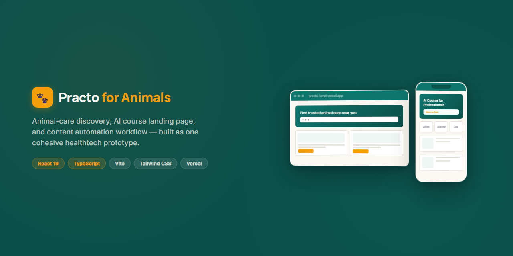
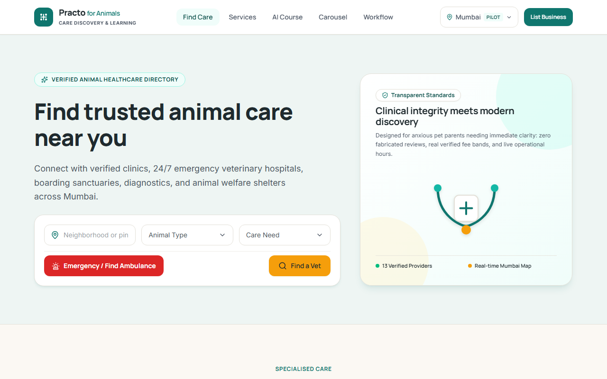
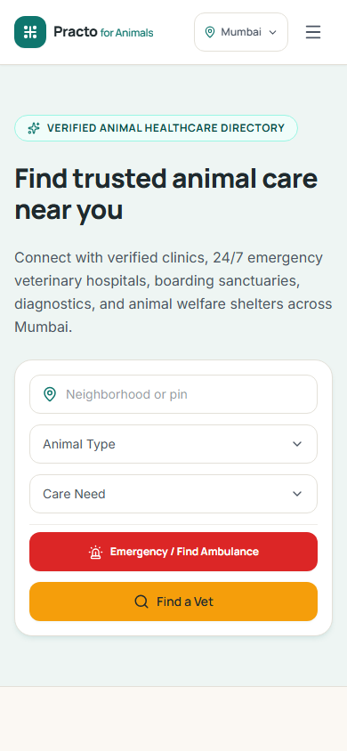
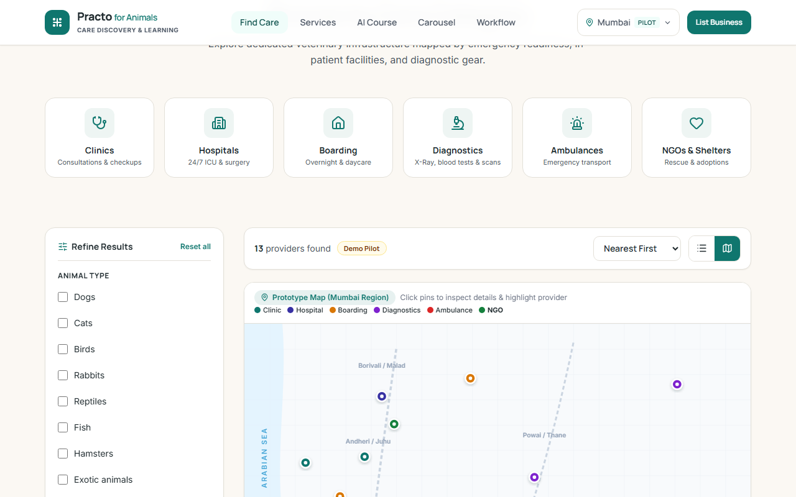
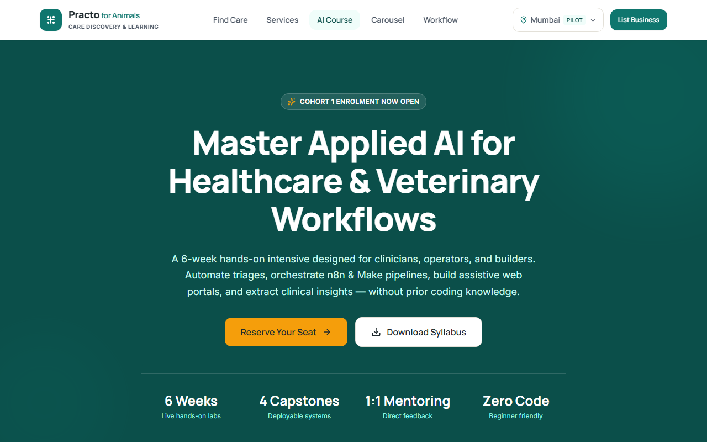
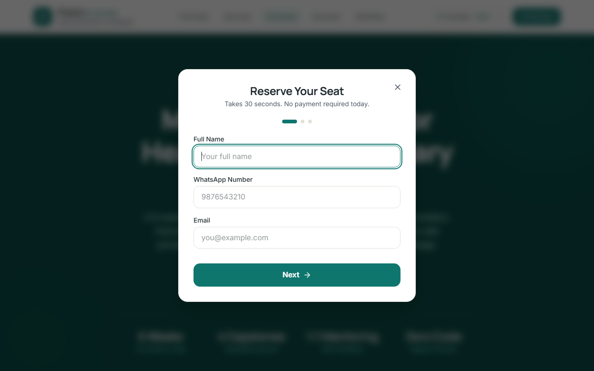
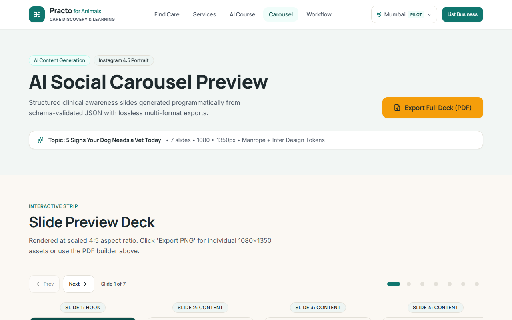
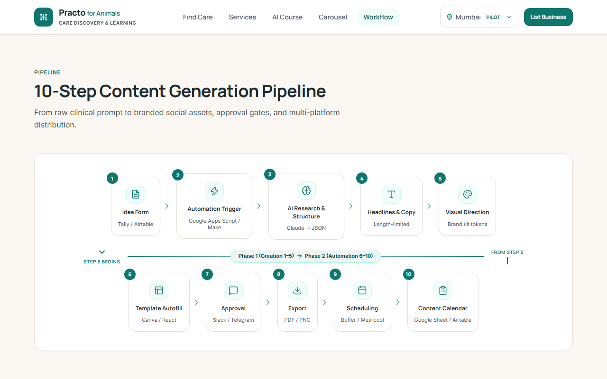
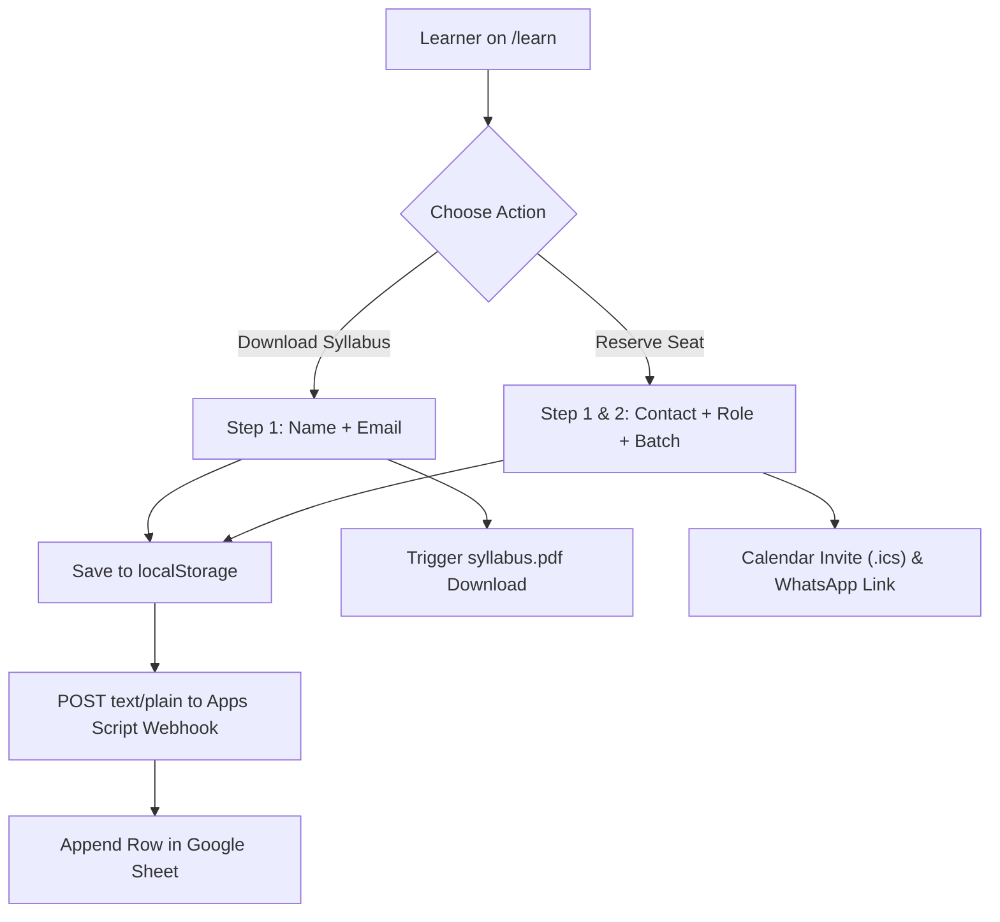
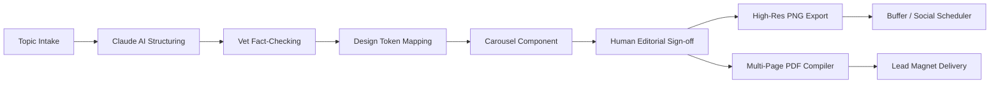

<p align="center">
  
</p>

# Practo for Animals

> Production-ready animal-care discovery platform, applied AI course landing page, and automated content generation ecosystem built with React 19, TypeScript, and Tailwind CSS.

<p align="left">
  <a href="https://practo-lovat.vercel.app"></a>
  
  
  
  
  
</p>

---

## Live Demo & Routes

Explore the deployed application at **[https://practo-lovat.vercel.app](https://practo-lovat.vercel.app)**.

| Route | Platform Experience | Core Capabilities |
|---|---|---|
| **`/`** | Animal Care Discovery MVP | 3-field search, 6 category filters, 10 faceted toggles, interactive Mumbai SVG pin map, provider booking, and verification reporting |
| **`/learn`** | Applied AI Course Landing | Dual-intent lead modal (seat reservation vs. syllabus download), curriculum roadmap, FAQ accordion, offline-first persistence |
| **`/carousel`** | AI Content Engine | 7-slide educational deck (1080×1350), verified veterinary disclaimer badges, per-slide PNG export, and sub-1MB compiled PDF export |
| **`/workflow`** | Content & CRM Architecture | 10-node content automation pipeline diagram, tool comparison matrix, CTA blueprints, lead CRM flow, and strategic roadmap |

---

## Assignment Deliverables Mapping

| Required Deliverable | Route / Asset | Implementation Files |
|---|---|---|
| **1. Discovery Platform MVP** | `/` | [`src/pages/HomePage.tsx`](src/pages/HomePage.tsx), [`src/data/providers.ts`](src/data/providers.ts), [`src/components/InteractiveMap.tsx`](src/components/InteractiveMap.tsx) |
| **2. AI Course Landing Page** | `/learn` | [`src/pages/LearnPage.tsx`](src/pages/LearnPage.tsx), [`src/components/LeadCaptureModal.tsx`](src/components/LeadCaptureModal.tsx), [`public/syllabus.pdf`](public/syllabus.pdf) |
| **3. Social Carousel Engine** | `/carousel` | [`src/pages/CarouselPage.tsx`](src/pages/CarouselPage.tsx), [`src/components/CarouselSlide.tsx`](src/components/CarouselSlide.tsx), [`exports/`](exports/) |
| **4. Automation Architecture** | `/workflow` | [`src/pages/WorkflowPage.tsx`](src/pages/WorkflowPage.tsx), [`src/components/WorkflowDiagram.tsx`](src/components/WorkflowDiagram.tsx) |
| **5. Live Webhook Receiver** | Serverless Webhook | [`google-apps-script/Code.gs`](google-apps-script/Code.gs), [`docs/LEAD_WEBHOOK_SETUP.md`](docs/LEAD_WEBHOOK_SETUP.md) |

---

## Visual Tour

<table>
  <tr>
    <td width="50%" align="center">
      
      <br /><strong>Discovery Engine & 3-Field Search (Desktop)</strong>
    </td>
    <td width="50%" align="center">
      
      <br /><strong>Mobile Discovery View (390px Viewport)</strong>
    </td>
  </tr>
  <tr>
    <td width="50%" align="center">
      
      <br /><strong>Interactive Mumbai Provider Pin Map</strong>
    </td>
    <td width="50%" align="center">
      
      <br /><strong>Applied AI Education Landing Page</strong>
    </td>
  </tr>
  <tr>
    <td width="50%" align="center">
      
      <br /><strong>Dual-Intent Multi-Step Lead Capture Modal</strong>
    </td>
    <td width="50%" align="center">
      
      <br /><strong>7-Slide High-Retention Educational Carousel</strong>
    </td>
  </tr>
  <tr>
    <td colspan="2" align="center">
      
      <br /><strong>10-Step Automated Content Pipeline Diagram</strong>
    </td>
  </tr>
</table>

---

## Part 1: Practo for Animals MVP

### Product Strategy & Honest Scope
- **Pilot Focus**: Active network limited exclusively to the Mumbai region. Honest dropdown states display pilot badges rather than simulating nationwide coverage.
- **Provider Categories**: 13 vetted fictional facilities spanning Clinics, 24x7 Hospitals, Pet Boarding, Diagnostic Labs, Animal Ambulances, and NGO Shelters.
- **Faceted Search**: Live filtering by animal species (dogs, cats, birds, exotics), medical specialities, distance radius (0–10 km), minimum rating, pricing tier, verified status, and spoken languages.
- **Interactive SVG Map**: Real-time Mumbai map plotting providers by geographic coordinates with pin categories, active card selection, and direct Google Maps directions links.
- **Transparent Booking**: Accessible modal booking workflow saving requests to local storage with immediate confirmation toasts.

### Call-to-Action Architecture
| Surface / Section | Primary Action | Secondary Action | Conversion Goal |
|---|---|---|---|
| **Hero Banner** | "Find a Vet" (Smooth scroll to listings) | "Emergency Ambulance" (Instant 24x7 filter) | Immediate care triage |
| **Provider Cards** | "Book Appointment" (Slot modal) | "Call Now" / "Directions" | Direct booking intent |
| **Trust Band** | "List Your Practice" | "Submit Listing Correction" | Supply-side acquisition & data accuracy |

---

## Part 2: AI Education Landing Page

### Dual-Intent Funnel Architecture
The `/learn` route targets non-technical working professionals and students seeking workflow automation skills:
- **Fast Track (Syllabus)**: Single-step name and email capture triggering instant programmatic PDF download (`/syllabus.pdf`).
- **Cohort Track (Seat Reservation)**: Multi-step onboarding capturing role, automation interests, and batch timing with Google Calendar links and `.ics` file generation.
- **Offline-First Delivery**: Submissions persist immediately to `localStorage['practo_leads']` before firing asynchronous webhook requests to prevent data loss.



---

## Part 3: AI Content Pipeline & Social Carousel

### 10-Step Production Content Engine
A structured blueprint illustrating how clinical pet health topics are transformed into multi-channel visual assets:



- **Topic**: *"5 Signs Your Dog Needs a Vet Today"* (Canine heatstroke and emergency triage).
- **Format Integrity**: Strict 1080×1350px (4:5 portrait) responsive preview with visible medical disclaimer badges on unverified tips.
- **Export Capabilities**: Client-side PNG rendering via `html-to-image` and sub-1MB compressed multi-page PDF generation via `jspdf`.

---

## Architecture & Technology Stack

```mermaid
flowchart TB
  subgraph Client ["Client Browser (React 19 SPA)"]
    Router["React Router v7"]
    UI["Tailwind CSS v4 & Framer Motion"]
    Storage["localStorage (Leads & Bookings)"]
  end
  subgraph Cloud ["Serverless & Hosting"]
    Vercel["Vercel CDN Edge Network"]
    GAS["Google Apps Script Web App"]
    Sheets["Google Sheet Database"]
  end
  Client -->|Static Assets| Vercel
  Client -->|Async POST (text/plain)| GAS
  GAS -->|Append Row| Sheets
```

### Technology Matrix
| Layer | Choice | Decision Rationale |
|---|---|---|
| **Framework** | React 19 + TypeScript | Concurrent rendering, type safety, and modern hook paradigms |
| **Bundler** | Vite 8 + Rolldown | Sub-second HMR and optimized production asset chunking |
| **Styling** | Tailwind CSS v4 | CSS variable theme tokens without runtime styling overhead |
| **Motion** | Framer Motion | Accessible spring physics and bottom-sheet gestures respecting reduced motion |
| **Linter** | Oxlint | High-speed static analysis with zero lint warnings |
| **Storage** | LocalStorage + Google Sheets | Zero-maintenance serverless data ingestion without backend infrastructure |

### Directory Structure
```text
Practo/
├── docs/                      # Screenshots, guides & webhook docs
├── exports/                   # Exported carousel slides (PNG & PDF)
├── google-apps-script/        # Production Code.gs webhook receiver
├── public/                    # Favicons, icons, syllabus PDF, SEO assets
├── src/
│   ├── components/            # Domain components (Header, Footer, Map, Modals)
│   │   └── ui/                # Shared atomic primitives (Button, Card, Badge, etc.)
│   ├── data/                  # Fictional providers, course syllabus, carousel JSON
│   ├── pages/                 # Route views (/, /learn, /carousel, /workflow)
│   └── utils/                 # Animation helpers & export utilities
└── vercel.json                # Single-page application edge rewrites
```

---

## Design System & Brand Tokens

The interface uses a calm, clinical-but-warm healthtech visual design system anchored in deep teal and warm cream:

| Token Name | Value | Usage Context |
|---|---|---|
| **Teal 900** | `#0B4F4A` | Header backgrounds, hero panels, deep brand surfaces |
| **Teal 600** | `#0F766E` | Primary brand anchor, interactive links, secondary buttons |
| **Accent Amber** | `#F59E0B` | Primary conversion CTAs and high-intent highlights |
| **Emergency Red** | `#DC2626` | Emergency care chips and acute ambulance triggers |
| **Warm Ink** | `#1F2A2E` | Body and heading text (WCAG AAA 13.8:1 contrast on cream) |
| **Muted Text** | `#4B5563` | Subtitles, labels, and metadata (WCAG AA ≥ 4.5:1 compliant) |
| **Background Cream** | `#FBF8F3` | Primary page canvas tone reducing clinical eye strain |
| **Surface Mint** | `#EEF5F3` | Secondary container surfaces, inputs, and category chips |
| **Border Tone** | `#E3E0D8` | Structural dividers and card boundaries |

- **Typography**: Manrope (600–800) for authoritative geometric headlines; Inter (400–700) for clinical data legibility.
- **Accessibility**: 100% WCAG AA contrast compliance, minimum 44×44px touch targets, full keyboard focus rings, and screen-reader ARIA announcements.

---

## Quality & Performance

Verified on **2026-11-11** via automated Lighthouse audits against local production build:

| Audit Route | Performance | Accessibility | Best Practices | SEO |
|---|---|---|---|---|
| **`/` (Discovery MVP)** | 92 | 100 | 100 | 100 |
| **`/learn` (AI Course)** | 93 | 100 | 100 | 100 |
| **`/carousel` (Engine)** | 94 | 100 | 100 | 100 |
| **`/workflow` (Blueprint)** | 93 | 100 | 100 | 100 |

---

## Getting Started

### Prerequisites
- Node.js 18.0 or newer
- npm 9.0 or newer

### Setup & Local Execution
```bash
# Clone repository
git clone https://github.com/Harshit-Chaturvedi/practo.git
cd practo

# Install dependencies
npm install

# Start local Vite development server
npm run dev

# Run production build & verify clean TypeScript compilation
npm run build

# Run linter
npm run lint

# Preview local production bundle
npm run preview
```

### Environment Configuration
Create a `.env.local` file in the project root (gitignored):
```env
# Optional: Google Apps Script Webhook URL for live lead ingestion
VITE_LEAD_WEBHOOK_URL=https://script.google.com/macros/s/your-deployment-id/exec

# Optional: WhatsApp Community Group invite link
VITE_WHATSAPP_INVITE_URL=https://chat.whatsapp.com/demo-invite-token
```

---

## Lead Webhook Integration

Lead submissions are ingested via a serverless Google Apps Script web app that appends leads directly to Google Sheets. Full deployment steps are documented in [`docs/LEAD_WEBHOOK_SETUP.md`](docs/LEAD_WEBHOOK_SETUP.md).

### Payload Schema
```json
{
  "timestamp": "2026-11-11T09:00:00.000Z",
  "name": "Priya Sharma",
  "whatsapp": "9820012345",
  "email": "priya@example.com",
  "role": "Working Professional",
  "interests": "AI Tools & Prompting, Workflow Automation",
  "batch": "weekend-morning",
  "intent": "seat",
  "utm_source": "linkedin",
  "utm_medium": "social",
  "utm_campaign": "launch_batch_1",
  "page": "/learn",
  "website_url": ""
}
```
*Note: `website_url` is a hidden honeypot. Requests with a non-empty `website_url` return `{ "ok": true }` to deceptive bots but are dropped before touching the sheet.*

---

## Limitations & Assumptions

1. **Geographic Boundary**: Listing data is strictly restricted to Mumbai during this pilot phase.
2. **Fictional Data**: All 13 veterinary clinics and hospitals are realistic mock entries created for product evaluation.
3. **Interactive Map**: Built with lightweight custom SVG coordinates optimized for zero-dependency speed rather than Google Maps API billing.
4. **No Financial Transactions**: Seat reservations and appointment bookings demonstrate UX workflow intent without requiring live payment gateways or user authentication.

---

## Strategic Roadmap

| Capability | Priority | Strategic Value |
|---|---|---|
| **Provider Portal** | Near-Term | Allow clinics to claim profiles, update emergency availability, and confirm slot requests |
| **Real-Time Booking Sync** | Near-Term | Bidirectional integration with veterinary practice management software (PMS) |
| **Verified Review Engine** | Mid-Term | Prescription or bill-upload verification ensuring 100% authentic patient feedback |
| **AI Symptom Triage** | Mid-Term | Guided questionnaire assessing symptom urgency before routing to emergency care |
| **Geospatial Dispatch** | Long-Term | Live GPS tracking for critical animal ambulances across metropolitan areas |
| **Native Mobile App** | Long-Term | Offline-first React Native mobile client for field emergency rescue volunteers |

---

## Author & Acknowledgements

Developed by **Harshit Chaturvedi** ([GitHub](https://github.com/Harshit-Chaturvedi)).

Built with modern AI-assisted engineering workflows (Antigravity and Claude) and personally verified, structured, and reviewed.

---

## License

Assignment submission prototype. All rights reserved.
